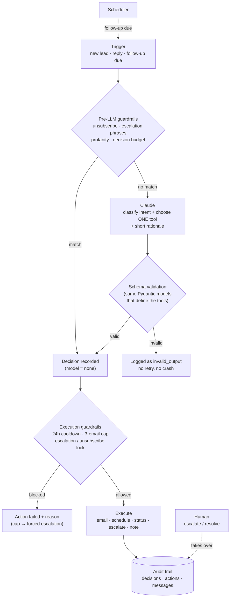

# AI Lead Follow-up Agent

**An LLM agent that follows up with sales leads, built so it can't go off the rails.**
Claude reads the conversation, classifies intent and picks exactly one action from a bounded tool set.
Code then validates the choice, applies deterministic guardrails, executes it and logs it.
Humans can take over at any time.


<!-- TODO: record a 30–45s demo and uncomment:
<p align="center"></p>
-->

## How it works



**The five tools:** `send_followup_email` · `schedule_followup` (1–14 days) · `update_lead_status` · `escalate_to_human` · `log_note`.
Nothing else is possible: no SQL, no deletes, no access to other leads.

**More detail:** [DESIGN.md](DESIGN.md) (problem, architecture, data model, guardrails) ·
[docs/dev-log.md](docs/dev-log.md) (decisions and bugs along the way) ·
[docs/manual-testing-guide.md](docs/manual-testing-guide.md) (exercise every path by hand).

**Status:** V1 complete: ingestion, agent core, tool execution, scheduler, guardrails, browser UI.
**Next:** an evaluation set for intent and action accuracy, and a hosted demo.

## Why this design

- **One bounded tool per event.** The model must call exactly one of five tools (`tool_choice: any`, strict schemas). There is no tool that deletes data, runs SQL or touches another lead.
- **Compliance never depends on the model.** "Unsubscribe", "speak to a human", escalation phrases and profanity are matched in code *before* the LLM is called (`app/agent/guardrails.py`).
- **The model decides, code acts.** Every tool call is re-validated against the same Pydantic models that generate the tool schemas, then passes execution-time guardrails (24h send cooldown, 3-email cap → forced escalation, escalation/unsubscribe lock). Execution is idempotent per decision.
- **Everything is auditable.** Each decision stores the trigger, an input snapshot, a short rationale, the model used (or `None` when a guardrail decided), and the resulting action.
- **Tested without the network.** 60 tests run against real Postgres with a fake LLM client; the live API path is verified by hand. That is how a strict-schema incompatibility that mocks couldn't catch was found and fixed (see `docs/dev-log.md`).

## Quickstart

Five steps to a running app. Run each block in order from the project root.

**1. Start Postgres** (needs Docker running)
```bash
docker compose up -d db
```

**2. Set up the Python environment** (first time only)
```bash
python3 -m venv .venv
source .venv/bin/activate
pip install -e ".[dev]"
cp .env.example .env
```
Already have a `.venv`? Just `source .venv/bin/activate`.

**3. Apply database migrations**
```bash
alembic upgrade head
```

**4. Load sample data** (optional, but recommended for a first look)
```bash
python -m scripts.seed
```

**5. Start the app**
```bash
uvicorn app.main:app --reload --port 8001
```
Open **http://localhost:8001/** in a browser.

## Using the app

| Page | What it's for |
|---|---|
| `/` | Landing page — submit a lead, same as a real form would. Redirects you to that lead's page. |
| `/dashboard` | Table of every lead: status, intent, owner, next follow-up. |
| `/dashboard/{id}` | One lead: message thread, agent decision log, action history, escalation history, a "simulate a reply" form, and escalate/resolve controls. |
| `/outbox` | Every email the agent has "sent" (mocked — no real delivery, see DESIGN.md §3). |

**Without an `ANTHROPIC_API_KEY`**, the agent's LLM calls fail gracefully (the lead/reply is
still recorded, the failure shows up as a logged decision) — this is by design, not a bug. The
**deterministic guardrails still work without a key**, since they intentionally bypass the LLM:
try submitting a message containing "unsubscribe" or "speak to a human" and watch it take effect
immediately.

**To see real agent behavior**, add a key to `.env`:
```
ANTHROPIC_API_KEY=sk-ant-...
```
then restart `uvicorn`.

### Optional: run the follow-up scheduler

In a second terminal, so scheduled follow-ups actually fire:
```bash
source .venv/bin/activate
python -m scripts.run_scheduler
```
Polls every 30s (configurable via `SCHEDULER_POLL_INTERVAL_SECONDS` in `.env`) for due follow-ups.

## Running tests

```bash
source .venv/bin/activate
pytest
```
Runs against a real Postgres database (`leadagent_test`, created automatically on the same
docker-compose instance, not SQLite — the schema uses Postgres-specific types). No network calls
and no API key needed: the agent's LLM client is replaced with a fake in every automated test.

## Project layout

```
app/
  agent/        agent core: classification, decisions, execution, guardrails, scheduler logic
  routers/      leads.py (JSON API), pages.py (server-rendered UI)
templates/      Jinja2 templates for the UI
static/         stylesheet
scripts/        seed.py (sample data), run_scheduler.py (follow-up polling loop)
migrations/     Alembic migrations
tests/          pytest suite (real Postgres, fake LLM client)
```

## Troubleshooting

- **Can't reach `localhost:8001`**: confirm `uvicorn` is actually running (check the terminal
  it's in, or `ps aux | grep uvicorn`). If it's running but still unreachable, and you're using a
  remote/devcontainer setup, the port may need forwarding to your local machine.
- **`pytest` or the app can't connect to Postgres**: `docker compose ps` — the `db` container
  doesn't survive a host/session restart, so you may need `docker compose up -d db` again.
